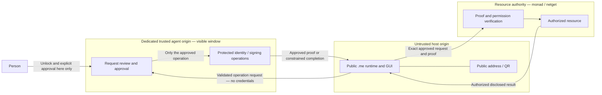

# Identity custody and operation authorization

Status: **design contract, not implemented** (2026-11-06).

This document defines the proposed custody boundary between a public `.me`
runtime, an isolated identity agent, and the servers that enforce access. It is
independent of [Modules-Plan.md](Modules-Plan.md). A GUI module registration,
package import, theme, overlay or document cannot grant access to the agent.
The identity agent is not another component mounted in an application's page.

Normative words below describe requirements of the proposed design, not current
implementation guarantees. Open decisions are implementation gates. Completing
this document completes the **custody-design step** only, not step 1 of the GUI
module plan and not a security audit or implementation acceptance.

## 1. The two responsibilities

| Responsibility | Work | Location and trust |
|---|---|---|
| Public runtime | Read disclosed trees, resolve expressions, compute local values, render GUI and public QR/address information | May run in an arbitrary application's origin. Receives no user root, private signing key, unlock secret or agent session. Its outputs are not server-side authorization evidence. |
| Identity agent | Hold protected identity material, unlock locally, explain a requested operation, obtain approval and produce its scoped proof | A dedicated trusted origin and visible top-level window for the first cut. No application modules, remote UI documents or third-party scripts execute here. |

"Public" means no secret custody, **not risk-free**. External trees, expressions,
URLs, QR payloads and declarative documents are untrusted input. They need bounded
parsing/computation, safe rendering and constrained network/actions. Receiving a
signed document establishes neither execution permission nor truthful contents.

GUI remains a presentation/runtime library. It may provide the public request UI;
installing GUI in an app does not make that origin a trusted identity agent.
An ordinary app must not receive an identity-bearing kernel, signing node or
callback that gives it unrestricted signing authority.

## 2. Current implementation boundary

Reviewed local source at GUI commit `ebd11615`, with the existing working-tree
changes left untouched. Relevant entry points:

- `src/react/session/SeedSessionProvider.tsx` receives username/secret in the
  page and opens identity-bearing sessions, including local-vault paths.
- `src/gui/All.This/Cleaker/signedRequest.ts` exposes identity-node derivation and
  creates `X-Me-Proof` requests from a page-held node. The challenge includes
  method, path, canonical query, body hash, nonce and timestamp; the proof is
  bound through the namespace-aware node. This is an existing protocol, not a
  substitute for the proposed requesting-origin/consent boundary.
- `src/core/session/createSeedSession.ts` exposes optional `signPayload` and
  `signAndWrite` session operations. Existing held-identity roots can be
  module-private without being isolated from code in the same execution realm.

The present page can therefore handle credentials and invoke identity operations.
Removing a secret from React state, hiding a root in a module, or making a key
non-exportable would not by itself stop hostile same-origin code from using the
available signing authority. This design must move the authority, not just hide
its representation. These observations are not a complete review of every
credential, vault, signing and server-verification path.

## 3. Actors and authority

| Actor | Authority | Explicit limit |
|---|---|---|
| Person | Select identity, approve/reject a concrete request, lock the agent | An approval must not silently expand to other origins, resources or operations. |
| Host page / public runtime | Display public data and request an operation | Cannot collect the unlock secret, unlock the identity, sign, export keys or claim that a username proves identity. |
| Identity agent | Manage custody and sign approved user operations | Does not grant privileges the person lacks on the target server. |
| Monad / resource server | Verify proofs, resource ownership, current permissions and replay rules | Must enforce every operation even when GUI is bypassed. Does not receive the person's root or sign as that person. |
| Netget / gateway | Enforce its resource policy and route authorized requests | Routing, a domain name, a visible control or an existing link does not confer identity authority. |

Servers can have their **own** service keys for their own attestations. Those are
not the person's keys. A valid user signature establishes proof under its defined
binding; it does not establish namespace ownership or permission without the
server's verified claim/key binding and current resource policy.

An identity provider hostname is not automatically a namespace authority. Agent
selection and its trusted origin must be explicit; routing/discovery results or a
QR must not silently replace the chosen agent. This contract does not require
every identity to use `cleaker.me` or establish new NRP claims.

## 4. Custody and permitted storage

- User root material, private signing keys, recovery material and unlock secrets
  MUST remain inside the agent's custody boundary during normal operation.
- Locking MUST disable signing and release usable in-memory key references as
  far as the platform permits. JavaScript cannot guarantee physical memory erasure.
- The host MUST NOT receive these values through props, kernels, messages,
  storage, URLs, logs, error reports or devtools projections. Sharing the agent's
  general session with the host is also prohibited.
- Public identity identifiers and verification keys MAY be disclosed explicitly.
  Disclosure must account for correlation between identities across sites.
- Persistent agent storage, encryption, unlock derivation, idle timeout,
  recovery, key rotation and backup format remain **Open**. No production identity
  custody is approved until those decisions and their tests exist.
- Encrypted recovery backups and additional authorized devices are separate,
  explicit custody events, not exceptions available to page requests. The first
  cut does not implement exporting, recovery or multi-device synchronization.

The agent is the only component in this flow authorized to produce the person's
operation proofs. This is an execution/authority boundary, not a claim that an
identity can never have a protected backup or another explicitly enrolled device.

## 5. Trust-boundary diagram

The diagram leaves the final delivery mechanism open. A concrete implementation
must choose whether the agent returns a proof for the exact request or executes
that request and returns a filtered result. It must not implement both loosely
and accidentally create a general proxy or signing endpoint.

## 6. First cut: one visible, read-only operation

Scope: approve reading the list of domains visible to the selected identity on
one configured gateway. This is an authenticated disclosure, not necessarily
public data. It is not permission to fetch logs, edit domains, alter nginx, reload
services, sign arbitrary content or read any other `.me` path.

1. The person activates the host's public identity control. A QR/address may
   contain public addressing information only, not a reusable authorization.
2. The host opens the explicitly selected agent in a visible top-level window.
   The first cut has no embedded unlock form or invisible signing frame.
3. Establish an authenticated-to-the-browser messaging relationship. Verify the
   requesting `event.origin` and expected `event.source`, and bind them to one
   pending request with an unpredictable identifier. An origin copied from a
   query string, label, referrer or message body is not this verification.
4. The agent displays the exact requesting origin (scheme, host, port), identity,
   gateway/resource, read action and expiry. Display names cannot hide the origin.
   The host must not be able to supply HTML or components for this screen.
5. Unlock and approve inside the agent. The person may reject or close the
   window. Authentication alone does not imply approval.
6. Produce a proof bound to the reviewed operation using the selected identity's
   existing cryptographic model and a reviewed, versioned protocol mapping.
   The host cannot edit the destination, namespace, query or payload afterward.
7. The resource server independently verifies the proof, current identity/key
   binding, resource permissions, expiry and replay policy before returning data.
8. Deliver only the authorized public identity/result/proof to the exact host
   window and origin, and close the pending request. No reusable general session
   is returned. Closing, timing out, navigation or protocol error denies the flow.

Requesting-origin checks protect the browser channel; they do not authenticate
arbitrary non-browser clients. Server enforcement still requires actual proofs
and authorization. A private/loopback resource must have an explicit trusted
destination policy; neither agent nor server may fetch arbitrary host-supplied URLs.

## 7. Operation and message requirements

This is a requirements list, **not a new wire format or new signature algorithm**.
Before coding, specify and test how the chosen transport/proof covers:

- protocol version, operation type and unambiguous canonical encoding;
- selected identity and verified namespace/claim relationship;
- browser-verified requesting origin and intended resource audience;
- exact authorized resource, method, path, canonical query and payload semantics;
- unpredictable request/challenge identifier, bounded validity and one-time
  execution policy, including atomic handling of concurrent replay;
- binding between the human-readable review, bytes signed and server execution;
- result delivery to the same pending request, with bounded sizes and timeouts.

No `sign(bytes)`, arbitrary expression execution, arbitrary fetch proxy, wildcard
permission, implicit delegation or automatic approval is exposed to the host.
No unsigned fallback is allowed for an operation that requires authorization.
The existing proof format/verifiers need a compatibility review before adding
origin, audience or approval semantics; do not silently reinterpret old proofs.

Messages are strictly validated data. No `eval`, executable callbacks, HTML or
host-provided component imports. Use exact `targetOrigin` for sensitive responses;
reject unexpected origins/sources, stale IDs, unsolicited responses and malformed
messages. Duplicate approvals cannot produce an additional authorized execution.

If OAuth/OIDC is chosen, use maintained implementations and the applicable code,
PKCE, issuer, CSRF and redirect-binding protections. A site may request consent
without gaining the right to receive credentials. Support for additional clients
is a defined admission/return-channel policy, not wildcard credentialed CORS or
an unchecked redirect URL.

## 8. Isolation, server enforcement and privacy

- Dedicated agent origin; a different path on the host's origin is insufficient.
  Review cookie scope, storage sharing, service workers and all scripts served
  there. Deploy the agent without app code or arbitrary modules.
- Agent unlock/approval pages reject framing and use restrictive CSP. The
  implementation must account for popup blocking, window navigation and browser
  isolation policies without weakening origin/source checks.
- Cross-origin sign-in with credentials entered into the host is not an accepted
  workaround for localhost. CORS and OPTIONS handling must be an explicit
  per-endpoint policy, never the server's permission check.
- Resource APIs enforce ownership/permissions on every HTTP request and each
  relevant WebSocket message. UI visibility resolvers do not grant permission.
- Loopback is not authentication. Validate local Host/origin and destinations,
  with appropriate CSRF, DNS-rebinding/SSRF and WebSocket protections. Public
  namespace resolution does not implicitly authorize access to private networks.
- Record decisions using bounded request IDs, action/resource and outcome; redact
  secrets, proof payloads, tokens and sensitive domain lists. Minimize cross-site
  identity disclosures and do not probe login state silently for tracking.

Opening the agent from an arbitrary site does not allow injecting a GUI overlay
into a site that has not integrated it. An extension or separate user-controlled
surface would be another product boundary and permission model, outside this cut.

## 9. Required negative tests

Use isolated host, agent and resource origins, plus an attacker page. No real
credentials, production backend, deployed nginx or external writes are required.

| Attempt | Required outcome |
|---|---|
| Host reads keys/secret/session via messages, kernel or browser storage | No custody material crosses the boundary. |
| Another origin/window copies a pending request identifier | Rejected by channel binding. |
| Host alters resource, namespace, method, query, body or audience after approval | Rejected; reviewed operation and execution cannot diverge. |
| Expired, reused or concurrent duplicate proof | Rejected or handled under the specified single-execution policy. |
| Valid identity with no domain-list permission; guessed resource ID | Denied by server policy, not merely hidden in GUI. |
| Cancellation, agent lock, popup close or failed signing | No protected request continues unsigned. |
| Embedded/fake approval, malicious QR, document or message payload | Cannot unlock or gain signing authority. |
| Arbitrary private destination / redirected proxy target | Denied by the destination policy. |
| Future module supplies signing callback or privileged runtime adapter | Rejected; module registration cannot cross the agent boundary. |
| Logout/revocation while a request is pending | Matches an explicit policy and cannot silently retain general authority. |

Availability/rate limits, lost-device recovery and compromised-agent/dependency
response need their own tests before broader release. Agent-origin XSS, a hostile
extension, or a compromised OS/browser can defeat this boundary; a visible window
and same-origin policy are not guarantees against those threats.

## 10. Decisions required before implementation

1. **Agent origin and trust bootstrap:** how the person selects/verifies it;
   deployment, key storage, unlock, lock and recovery policy.
2. **Proof mapping:** exact relationship to current `.me`/cleaker proofs and
   monad/netget verifiers; origin/audience binding and backwards compatibility.
3. **Transport:** popup handshake/return mechanism, cancellation, navigation,
   protocol version and browser compatibility. Choose proof return versus
   agent-mediated resource access and constrain the selected mechanism.
4. **Resource policy:** exact domain-list endpoint/projection, gateway identity,
   destinations and redaction; independent server authorization and replay store.
5. **Migration:** enumerate every credential/vault/signing entry point, including
   existing `signedRequest`, `signPayload`, `signAndWrite`, recovery/link flows,
   legacy UMD and scaffold consumers. Do not remove current APIs until consumers
   have a reviewed migration; do not call the new boundary deployed while an
   ordinary host can still acquire the same user's signing authority.

Design acceptance: the custody owner, allowed users of key material, boundary
crossings, open gates and first-cut negative tests are explicit here. Implementation
acceptance additionally requires resolved gates, passing tests, operational
revocation/recovery policy and independent security review appropriate to exposure.
No new signing service, CORS policy, nginx deployment or code change is authorized
or implemented by this document.

Dated evidence for gates 2 and 5 (what the code does, not requirements):
[client inventory](evidence/2026-11-10-client-custody-inventory.md),
[verifier map](evidence/2026-11-10-server-verifier-map.md); proposal built on them:
[Identity-Proof-Migration.md](Identity-Proof-Migration.md).

## References

- [Runtime Contract](Runtime-Contract.md): existing GUI runtime API, not a custody
  isolation guarantee.
- [Modules Plan](Modules-Plan.md): local module composition; remote code and
  personal overlays remain separate stages.
- [Interface binding principle](Interface-Binding-Principle.md): proposed principle
  for binding the interface to `.me` operations; grants nothing and amends no gate here.
- [NRP v0.3.0](https://neurons-me.github.io/NRP/v.0.3.0.html): namespace/transport
  separation; this design does not amend the protocol.
- [OAuth Security BCP — RFC 9700](https://www.rfc-editor.org/info/rfc9700/).
- [OAuth for Browser-Based Applications — RFC 10017](https://www.rfc-editor.org/rfc/rfc10017.html).
- [OWASP HTML5 Security](https://cheatsheetseries.owasp.org/cheatsheets/HTML5_Security_Cheat_Sheet.html).
- [OWASP Transaction Authorization](https://cheatsheetseries.owasp.org/cheatsheets/Transaction_Authorization_Cheat_Sheet.html).
- [OWASP ASVS](https://asvs.owasp.org/): verification inventory, not a certification
  automatically conferred by this design.
